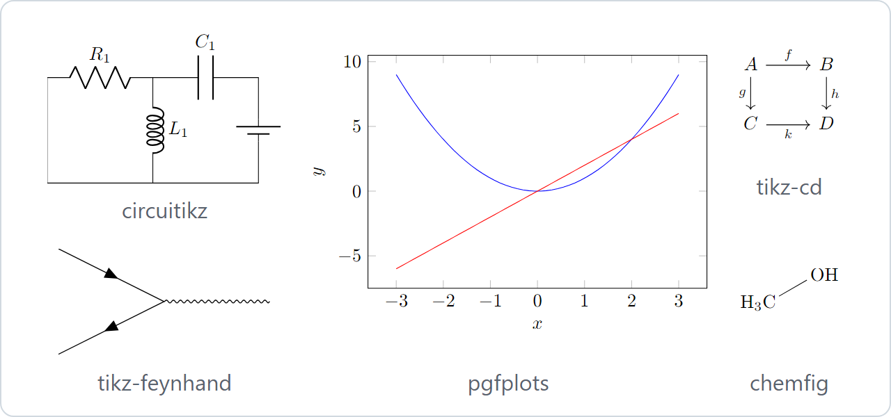
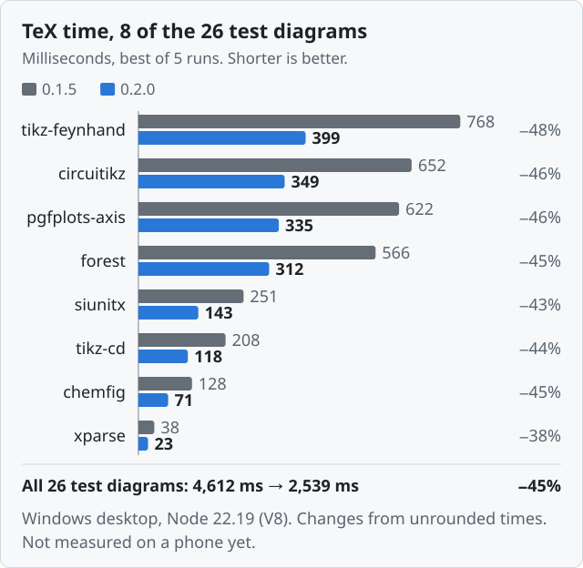
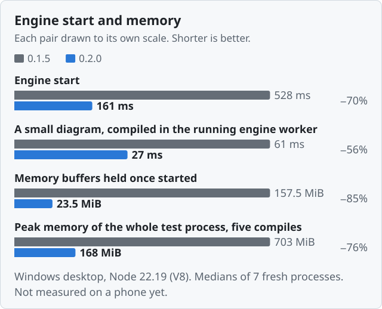
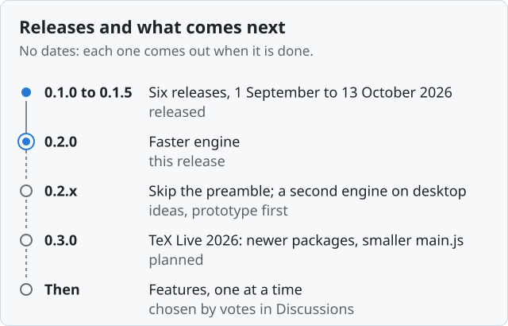

# TikZJax Next

Draw TikZ and LaTeX diagrams in Obsidian notes: write the code in a `tikz` block and the note shows
the picture. pgfplots, circuitikz, chemfig, tikz-cd, forest and a hundred TikZ and pgfplots
libraries are built in. TeX runs inside the plugin, compiled to WebAssembly, so there is nothing
else to install, nothing is uploaded and nothing is fetched. It works offline, on desktop, iPhone
and iPad, and needs Obsidian 1.7.2 or later.

It is a fork of [artisticat1/obsidian-tikzjax](https://github.com/artisticat1/obsidian-tikzjax),
which had not been updated since 2022. Version 0.2.0 rebuilds the TeX engine: on a desktop, TeX
now takes a little over half the time it took in 0.1.5.

<!-- IPHONE-FIGURES: once phone figures exist (see the marker under "## 0.2.0"), add here in one clause what 0.2.0 does on an iPhone, with the device named there. Until then this paragraph speaks only of the desktop. -->

<div align="center">

[](https://github.com/JackVinati/tikzjax-next/releases/latest)
[](https://github.com/JackVinati/tikzjax-next/actions/workflows/ci.yml)
[](https://obsidian.md/plugins?id=tikzjax-next)

</div>

````markdown
```tikz
\begin{tikzpicture}
  \draw (0,0) circle (1cm);
  \node at (0,-1.6) {hello};
\end{tikzpicture}
```
````

<div align="center">



Five of the plugin's test diagrams, as 0.2.0 draws them.

</div>

## 0.2.0

<div align="center">



</div>

Over the 26 test diagrams 0.1.5 was released with, TeX's time went from 4,612 ms to 2,539 ms, 45%
less, and each diagram took between 37% and 48% less. The 11 test diagrams added since are left
out, because 0.1.5 cannot finish some of them. Each figure is the best of five runs, and a second
run of the whole benchmark gave 45% again. 24 of the 26 diagrams came out byte for byte as on
0.1.5; the other two, `mathfrak` and `mathscr`, give no SVG on either version (see
[Known limitations](#known-limitations)).

Most of the gain comes from removing asyncify, code compiled into every function of the engine so
that WebAssembly could pause while JavaScript fetched a file. By 0.1.5 only TeX's jump out on a
fatal error still used it, and every function still paid for it. Spreading TeX's macro names over
more of its hash table, so that finding one takes shorter searches, saves a few percent more.

I measured this in Node 22.19 on my Windows desktop, not inside Obsidian. Node runs the same
JavaScript engine, V8, as Obsidian's desktop app.

<details>
<summary>All 26 test diagrams</summary>

<table>
<thead><tr><th>Test diagram</th><th>0.1.5 (ms)</th><th>0.2.0 (ms)</th><th>Change</th></tr></thead>
<tbody>
<tr><td><code>feynhand</code></td><td align="right">768</td><td align="right">399</td><td align="right">−48%</td></tr>
<tr><td><code>circuitikz</code></td><td align="right">652</td><td align="right">349</td><td align="right">−46%</td></tr>
<tr><td><code>pgfplots-axis</code></td><td align="right">622</td><td align="right">335</td><td align="right">−46%</td></tr>
<tr><td><code>pgfplots-fillbetween</code></td><td align="right">613</td><td align="right">332</td><td align="right">−46%</td></tr>
<tr><td><code>forest</code></td><td align="right">566</td><td align="right">312</td><td align="right">−45%</td></tr>
<tr><td><code>siunitx</code></td><td align="right">251</td><td align="right">143</td><td align="right">−43%</td></tr>
<tr><td><code>tikz-cd</code></td><td align="right">208</td><td align="right">118</td><td align="right">−44%</td></tr>
<tr><td><code>chemfig</code></td><td align="right">128</td><td align="right">71</td><td align="right">−45%</td></tr>
<tr><td><code>mathtools</code></td><td align="right">89</td><td align="right">53</td><td align="right">−40%</td></tr>
<tr><td><code>arrows-meta</code></td><td align="right">81</td><td align="right">46</td><td align="right">−43%</td></tr>
<tr><td><code>patterns</code></td><td align="right">79</td><td align="right">47</td><td align="right">−41%</td></tr>
<tr><td><code>ts1-currency</code></td><td align="right">48</td><td align="right">30</td><td align="right">−39%</td></tr>
<tr><td><code>ts1-symbols</code></td><td align="right">44</td><td align="right">26</td><td align="right">−41%</td></tr>
<tr><td><code>dieresis</code></td><td align="right">43</td><td align="right">24</td><td align="right">−43%</td></tr>
<tr><td><code>ts1-small-caps</code></td><td align="right">42</td><td align="right">25</td><td align="right">−39%</td></tr>
<tr><td><code>shading</code></td><td align="right">41</td><td align="right">24</td><td align="right">−41%</td></tr>
<tr><td><code>xparse</code></td><td align="right">38</td><td align="right">23</td><td align="right">−38%</td></tr>
<tr><td><code>l-stroke</code></td><td align="right">37</td><td align="right">22</td><td align="right">−40%</td></tr>
<tr><td><code>rule-frac</code></td><td align="right">36</td><td align="right">22</td><td align="right">−39%</td></tr>
<tr><td><code>mathfrak</code></td><td align="right">35</td><td align="right">21</td><td align="right">−40%</td></tr>
<tr><td><code>mathscr</code></td><td align="right">35</td><td align="right">21</td><td align="right">−39%</td></tr>
<tr><td><code>expl3</code></td><td align="right">34</td><td align="right">21</td><td align="right">−38%</td></tr>
<tr><td><code>basic</code></td><td align="right">33</td><td align="right">20</td><td align="right">−41%</td></tr>
<tr><td><code>white-fill</code></td><td align="right">32</td><td align="right">19</td><td align="right">−40%</td></tr>
<tr><td><code>omega-otimes</code></td><td align="right">30</td><td align="right">19</td><td align="right">−38%</td></tr>
<tr><td><code>broken</code> (an error on purpose)</td><td align="right">26</td><td align="right">16</td><td align="right">−37%</td></tr>
<tr><td>All 26</td><td align="right">4,612</td><td align="right">2,539</td><td align="right">−45%</td></tr>
</tbody>
</table>

TeX's time only, best of five runs, in milliseconds. The changes were worked out before rounding,
so they can differ by a point from what the rounded times give.

</details>

On a desktop, the engine also starts about three times as fast and holds far less memory.

<div align="center">



</div>

TeX's starting memory image is 156 MiB, mostly zeros. 0.2.0 ships, unpacks and copies only the
parts that hold anything, so setting up TeX's memory before each compile takes about 5 ms, where it
took about 29, timed on its own.

| On the same desktop | 0.1.5 | 0.2.0 |
| --- | ---: | ---: |
| Engine start | 528&nbsp;ms | 161&nbsp;ms |
| A small diagram, compiled in the engine worker once it is running | 61&nbsp;ms | 27&nbsp;ms |
| Memory buffers held once started | 157.5&nbsp;MiB | 23.5&nbsp;MiB |
| Peak memory of the whole test process over five compiles | 703&nbsp;MiB | 168&nbsp;MiB |

Medians of seven fresh processes, each starting the plugin's engine worker and compiling five
diagrams. The small diagram's time is the worker's own (memory reset, TeX, DVI to SVG); waiting in
the queue and the plugin's SVG pipeline come on top.

Nothing has been measured on an iPhone or iPad yet, and these figures do not carry over to them:
Obsidian there runs JavaScriptCore, not V8. The diagnostics view now shows where each diagram's
time goes (waiting, engine start, memory reset, TeX, DVI to SVG, SVG pipeline), and I will read the
phone figures off it.

<!-- IPHONE-FIGURES: TeX time, engine start and a small diagram on iPhone/iPad, 0.1.5 against 0.2.0, are not measured yet. When they are: fill the two `iphone` entries in scripts/readme-charts.mjs (device, iOS version, Obsidian version, number of runs, and the ms read off the diagnostics view on the twenty-diagram note), run `node scripts/readme-charts.mjs`, and add the two phone charts it writes, docs/images/tex-time-iphone-0.2.0.svg and docs/images/engine-iphone-0.2.0.svg, here as image lines like the desktop ones. Then replace the paragraph above, "Nothing has been measured on an iPhone or iPad yet ...", with one sentence naming the device, the iOS version and the Obsidian version, and say in the introduction what 0.2.0 does there. -->

Also in 0.2.0:

- A diagram on which TeX gives up, with a macro that never stops expanding, an emergency stop or a
  hundred errors, fails at once with TeX's message. In 0.1.5 it waited out its time limit and was
  reported as too slow.
- `~` is a non-breaking space, as in LaTeX. In 0.1.5 every `~` gave three TeX errors and a stray
  tilde.
- Accented letters work where LaTeX makes a name of them: node and coordinate names, style names,
  `\label` keys and `\edef`.
- A diagram that loads a package the engine does not have is drawn without it, with LaTeX's
  ``File `x.sty' not found`` on it, so it says which package is missing. An `\input` of a missing
  file stops at once with LaTeX's message.
- `pgfplotstable` loads. Two of its files were missing, and a diagram that used it never finished.

After updating, every cached diagram is compiled once more, the next time it is shown, because the
engine is part of each diagram's cache key. Diagrams that rendered before come out the same, byte
for byte, apart from the changes above. Everything that changed is in the
[changelog](CHANGELOG.md).

## Installing

In Obsidian 1.7.2 or later: Settings → Community plugins → Browse, search for **TikZJax Next**,
install, enable.

To install by hand instead, download `main.js`, `manifest.json` and `styles.css` from a
[release](https://github.com/JackVinati/tikzjax-next/releases) into
`<vault>/.obsidian/plugins/tikzjax-next/` and enable it in Settings.

Disable the original TikZJax plugin first if you have it. The two have different plugin ids, so
they can be installed side by side, but both register the `tikz` code block and would render every
diagram twice. This plugin checks for that and refuses to start rather than doing it quietly.

If you had the original installed, its rendered diagrams are reused instead of being recompiled.
Its cache is only read, never modified, so it keeps working if you go back to it.

## Writing diagrams

A `tikz` block holds what a LaTeX file would, minus the `\documentclass` line: the engine starts
from the `standalone` class with TikZ and `xcolor` already loaded, and a second class is an error. A
block that is only a `tikzpicture` is wrapped in `\begin{document}` … `\end{document}` for you.

To load packages or libraries, write them the way a LaTeX file would, ahead of an explicit
`\begin{document}`:

````markdown
```tikz
\usepackage{pgfplots}
\pgfplotsset{compat=1.18}
\usepgfplotslibrary{fillbetween}
\begin{document}
\begin{tikzpicture}
  \begin{axis}[width=8cm, height=5cm]
    \addplot[name path=a, domain=0:3] {x};
    \addplot[name path=b, domain=0:3] {0.5*x^2};
    \addplot[gray!40] fill between[of=a and b];
  \end{axis}
\end{tikzpicture}
\end{document}
```
````

…or name them in a `%!tikz` line (below) and keep the block to the picture. A diagram renders when
it scrolls into view; one you have seen before appears instantly, from the cache, in the same frame
as the text around it. When TeX reports an error, the block shows it with its line (or, for an
error in a preamble file, that file and its line) and, where it can, what to change; a mistyped
macro usually still renders the rest of the diagram.

Accented letters work as typed, dieresis and `Ł` included (Grüße, naïve, `\"u`, Łódź), also in node
names, style names and `\label` keys. So do `°` `×` `±` `µ` `→` `£` `€` `©` `®`, `\$`, list bullets
and siunitx's units; see the limitations below for the characters that do not.
[`test/vault/TikZ-smoke-test.md`](test/vault/TikZ-smoke-test.md) is a note full of examples to copy
from.

## Per-block options

Options go in the block body, as `%!tikz` lines. They are stripped before the source reaches TeX.

````markdown
```tikz
%!tikz width=420 align=left colors=paper alt="RC low-pass filter"
%!tikz packages=circuitikz libraries=arrows.meta
\begin{circuitikz}
  \draw (0,0) to[R=$R$] (2,0) to[C=$C$] (2,-2) -- (0,-2) -- (0,0);
\end{circuitikz}
```
````

| Key | Values |
| --- | --- |
| `width`, `max-width`, `scale` | CSS length, or a number for `scale` |
| `align` | `left`, `center`, `right` |
| `alt` | quoted text, used as the accessible name. `alt=""` marks a diagram decorative |
| `colors` | `adapt` (default), `preserve`, `paper`, `invert` |
| `lazy` | `on`, `off`, `manual` |
| `timeout` | seconds, or a duration such as `500ms` |
| `packages` | comma list, `name[options]` accepted |
| `libraries` | comma list, passed to `\usetikzlibrary` |
| `border` | a TeX length, adds a margin around the diagram |
| `preamble` | a `.tex` file in the vault, put in front of the block. See below |
| `twopass` | runs TeX a second time when the first run left something to re-read, so `\label` and `\ref` resolve. Off by default: it can double the compile time |
| `wrap` | `auto` (default) wraps the block in `\begin{document}` … `\end{document}` unless it has one; `always` and `never` decide for it |
| `fast` | skips SVG optimisation and the pre-flight check, and renders ahead of other diagrams |
| `svgo` | `off` leaves the engine's SVG as it is; `targeted` and the default `preset` simplify how text is placed and drop an attribute browsers disagree on |
| `raw` | runs only the mandatory pipeline stages |
| `nocache` | skips the cache in both directions |

They are not written in the code fence line (` ```tikz width=420 `). Obsidian cannot read the fence
tail during PDF export, in embeds or in hover previews, so the same block would hash to two
different cache keys and the PDF would get a differently compiled diagram.

The plugin's settings cover colours, lazy rendering, fast mode, the time limit, how the source is
cleaned up, the pre-flight checks, the preamble files, the TeX log and the cache. A change applies
to the open notes straight away, also when it arrives from another device through Sync. Where an
option shares its name with a setting (`colors`, `lazy`, `timeout`, `fast`) the option wins for its
block.

## Shared preambles

Macros, styles and packages that many diagrams use can live in a `.tex` file in the vault instead
of being repeated in every block. A preamble goes where a LaTeX preamble goes, before
`\begin{document}`, so it holds `\usepackage`, `\usetikzlibrary`, `\newcommand`, `\tikzset` and
`\pgfplotsset`.

`latex/diagrams.tex`:

```tex
\usetikzlibrary{arrows.meta, positioning}
\tikzset{box/.style={draw, rounded corners, inner sep=6pt}}
\newcommand{\vect}[1]{\mathbf{#1}}
```

A note:

````markdown
```tikz
%:input latex/diagrams.tex
\begin{tikzpicture}
  \node[box] (f) {$f(\vect{x}) = A\vect{x}$};
  \node[box, right=of f] (g) {$g$};
  \draw[-Stealth] (f) -- (g);
\end{tikzpicture}
```
````

Four things can name a preamble file. Every one that applies is used, in this order, so a later
file can use what an earlier one defines:

1. **The vault-wide preamble**: Settings → Preamble → Preamble file, a path in the vault. The field
   suggests the vault's `.tex`, `.sty`, `.ltx`, `.def` and `.txt` files as you type; the path takes
   effect when you pick one, press Enter or leave the field.
2. **A folder preamble**: a file named `tikz-preamble.tex` in the note's folder, or failing that the
   nearest folder above it, up to the root of the vault. Only the nearest one is used. The name is
   Settings → Preamble → Folder preamble file name, which takes effect the same way; empty turns
   the search off.
3. **`%!tikz preamble=path/to/file.tex`** in the block.
4. **`%:input path/to/file.tex`** lines in the block, in the order they are written. A preamble file
   can `%:input` other files as well.

Paths resolve the way a `[[link]]` does: relative to the file that wrote them (the note, or the
preamble file for a nested `%:input`) and otherwise by name anywhere in the vault. A file named
twice is included once. A file that cannot be found, or a loop of `%:input`s, shows a note under the
diagram saying which file and who asked for it; nothing is silently left out. Inside a preamble file
only `%:input` lines are read as directives: a `%!tikz` line there is a TeX comment and changes
nothing.

The contents of every preamble file are part of the cache key of each diagram that uses it. Edit
the file and those diagrams, and only those, are compiled again the next time they render; a stale
one is never served from the cache. Open notes re-render straight away, in Reading view and in Live
Preview. When TeX stops on a line of a preamble file, the error card names the file and the line.

## Commands

| Command | What it does |
| --- | --- |
| Copy the diagram at the cursor as SVG | Puts the rendered SVG on the clipboard, theme-neutral, so it opens correctly outside Obsidian. |
| Save the diagram at the cursor as an SVG file | Writes it to your attachment folder. |
| Finalize the diagrams in this note | Saves each diagram as an attachment and rewrites the note as `![[diagram.svg]]` with the original fence preserved verbatim inside an Obsidian `%%` comment. The point is that the note now renders without this plugin: in Publish, in another editor, on GitHub. |
| Un-finalize the diagrams in this note | The exact inverse. The source was never thrown away. |
| Render all diagrams in this note | Ignores lazy rendering and compiles everything now, with a Stop button, and says how many rendered. |
| Open the diagram at the cursor in a zoom view | A scrollable, zoomable view of one diagram. |
| Open TikZ diagnostics | The TeX log, the cache key, and where each recent compile's time went. Start here when a diagram does something inexplicable. |
| Clear the diagram cache | Forgets every diagram this plugin has rendered; each compiles again when it is next shown. |
| Restart the TeX engine | Stops the engine, which starts again with the next diagram, and lets diagrams that failed in this session try again. |

The commands about the diagram at the cursor, and Finalize and Un-finalize, need the note open in
the editor, in Live Preview or Source mode; they are not offered in Reading view. Finalize leaves
alone a diagram in a blockquote or a callout, and one whose fence starts on the list item's own
line (`1. ```tikz`); copy or save those as SVG instead.

## What is bundled

The engine is e-TeX with a LaTeX format, built from TeX Live 2023 as Ubuntu 24.04 packages it.
The main packages, with the versions the engine reports (Settings → Bundled TeX engine shows them
for the installed build):

| Package | Version |
| --- | --- |
| pgf/TikZ | 3.1.10 |
| pgfplots, pgfplotstable | 1.18.1 |
| circuitikz | 1.6.6 |
| chemfig | 1.66 |
| siunitx | 3.3.10 |
| tikz-cd | 1.0 |
| amsmath | 2.17o |
| expl3 | 2024-01-22 |
| xparse | 2023-10-10 |
| standalone class | 1.3b |

0.2.0 changes the engine, not the packages: these are the versions 0.1.5 had. Newer ones come with
TeX Live 2026 in 0.3.0.

Loaded before your block starts: the `standalone` class, `tikz` (with `pgf`) and `xcolor`. Besides
those, there are 42 packages (counting the ones the others load), 84 TikZ libraries and 16 pgfplots
libraries, from 247 TeX files. The lists below are taken from the build itself, and a test keeps
them in step with it.

**Packages**, for `\usepackage` or `%!tikz packages=`, including the ones the others load:
<!-- bundled:packages -->
`amsbsy` `amsfonts` `amsgen` `amsmath` `amsopn` `amssymb` `amstext` `array` `atveryend`
`atveryend-ltx` `calc` `chemfig` `circuitikz` `color` `elocalloc` `environ` `etoolbox` `eufrak`
`expl3` `forest` `hf-tikz` `ifthen` `infwarerr` `inlinedef` `keyval` `ltxcmds` `mathrsfs`
`mathtools` `mhsetup` `pdftexcmds` `pgfcalendar` `pgfopts` `pgfplots` `pgfplotstable` `preview`
`siunitx` `tikz-3dplot` `tikz-cd` `tikz-feynhand` `translations` `trimspaces` `xparse`
<!-- /bundled:packages -->

**TikZ libraries**, for `\usetikzlibrary` or `%!tikz libraries=`:
<!-- bundled:tikz-libraries -->
`3d` `angles` `animations` `arrows` `arrows.meta` `automata` `babel` `backgrounds` `bbox` `bending`
`calc` `calendar` `cd` `chains` `circuits` `circuits.ee` `circuits.ee.IEC` `circuits.logic`
`circuits.logic.CDH` `circuits.logic.IEC` `circuits.logic.US` `curvilinear` `datavisualization`
`datavisualization.3d` `datavisualization.barcharts` `datavisualization.formats.functions`
`datavisualization.polar` `datavisualization.sparklines` `decorations` `decorations.footprints`
`decorations.fractals` `decorations.markings` `decorations.pathmorphing`
`decorations.pathreplacing` `decorations.shapes` `decorations.softclip` `decorations.text` `er`
`external` `fadings` `feynhand` `fillbetween` `fit` `fixedpointarithmetic` `folding` `fpu`
`graphs` `graphs.standard` `intersections` `lindenmayersystems` `math` `matrix` `mindmap`
`patterns` `patterns.meta` `perspective` `petri` `plothandlers` `plotmarks` `positioning` `quotes`
`rdf` `scopes` `shadings` `shadows` `shapes` `shapes.arrows` `shapes.callouts` `shapes.gates.ee`
`shapes.gates.ee.IEC` `shapes.gates.logic` `shapes.gates.logic.IEC` `shapes.gates.logic.US`
`shapes.geometric` `shapes.misc` `shapes.multipart` `shapes.symbols` `snakes` `spy` `svg.path`
`through` `trees` `turtle` `views`
<!-- /bundled:tikz-libraries -->

**pgfplots libraries**, for `\usepgfplotslibrary`:
<!-- bundled:pgfplots-libraries -->
`clickable` `colorbrewer` `colormaps` `colortol` `contourlua` `dateplot` `decorations.softclip`
`fillbetween` `groupplots` `patchplots` `polar` `smithchart` `statistics` `surfshading` `ternary`
`units`
<!-- /bundled:pgfplots-libraries -->

Being in the list means the file is there, not that everything in it can work: `contourlua` needs
LuaTeX and `external` needs to run programs, and this engine has neither. What a fixture in
`test/fixtures/tex` renders end to end through the shipped worker, on every CI run: plain TikZ,
`pgfplots` including its libraries, `pgfplotstable`, `circuitikz`, `chemfig`, `tikz-cd`, `forest`,
`mathtools`, `xparse`, `siunitx`, `tikz-feynhand`, `arrows.meta`, shadings, `~`, letters with a
dieresis, `Ł` and `ł`, accented node and style names (`(café)`, `grün`), and `°` `×` `→` `±` `µ`
`£` `€` `$` `©` `®` `ª` `º` with their text commands. The `patterns` library loads too, but see the
limitations below.

## Known limitations

| | |
| --- | --- |
| `\mathfrak`, `\mathscr` | TeX compiles them, and then the diagram fails: the DVI-to-SVG converter has a fixed font table, and it has neither the Euler fonts nor rsfs. For `\mathfrak` the Euler face and its metrics both ship, so the fix is in `@drgrice1/dvi2html`. `\mathscr` (rsfs) has only its metrics bundled and no face at all, so it would need a face built as well as a converter change. |
| `patterns` draws nothing | The driver emits the pattern reference but not the pattern definition. |
| `chemfig`'s `\schemestart` loses bonds | The bonds are already missing in the DVI, before any JavaScript runs. |
| `tikz-feynman` | LuaTeX only. `tikz-feynhand` is bundled and works. |
| Greek, Cyrillic, CJK, IPA, emoji | Not set up in this engine's LaTeX format: TeX leaves them out with an error. Most accented Latin letters work as typed (Dvořák, Erdős, İstanbul, Łódź, café, Grüße, naïve), as do curly quotes, dashes and `…`; the exact set is measured from the engine and listed in `src/source/native-unicode.ts`. In typewriter type `Ł` and `ł` show a `␣` where the stroke should be, because that font has one in its place. |
| `¥` `¢` `‰` `½` `№`, `\textcircled` | They come from the TS1 text companion font, which the SVG converter cannot draw, and the diagram fails. Pre-flight warns about the typed ones. `°` `×` `±` `µ` `·` `÷` `¬` `§` `¶` `†` `‡` `•` `™` `℃` `←` `↑` `→` `↓` `Ω` and `²` `³` `¹`, their `\text…` commands, siunitx's units (`\degree`, `\micro`, `\ohm` and the rest), `\S`, `\dag` and list bullets do render: they are drawn from the math fonts instead, so `µ` comes out as the italic math `μ`. So do `£` `€` `©` `®` `ª` `º`, their `\text…` commands, `\pounds`, `\copyright` and `\$`, built from the Computer Modern text fonts, mostly as older LaTeX releases built them: `€` is a C with a small `=` across it, LaTeX's own stand-in for a font without a euro, and in bold type `£` and `®` stay medium weight. |
| Obsidian Sync Standard does not sync `main.js` | It is 12.2 MB (11.7 MiB), and that plan caps a file at 5 MB. The plugin still installs from the community browser or a release on every device; only syncing the plugin folder itself is affected. The size is the TeX engine (the 22 MiB of its 156 MiB core dump that holds anything, gzipped and base64'd), and shrinking it means a smaller engine, not tighter code. TeX Live 2026 in 0.3.0 should bring it to about 8.3 MB, still over the limit. |
| Obsidian Publish | Publish runs no community plugins. Save the diagram as an SVG attachment, or finalize the note, and the result publishes as ordinary content. |

## Platforms

| Platform | State |
| --- | --- |
| Windows, macOS, Linux | Works on Windows, which is what I use and where every figure above was measured. macOS and Linux run the same code, but I have not tried them. |
| iPhone and iPad | Works: the engine compiles and diagrams render on the device, as checked on an iPhone (below). It is slower than on a desktop, and the first diagram that is not cached is the slowest, because it starts the engine. |
| Android | Not tried yet. A report either way is welcome, in [Q&A](https://github.com/JackVinati/tikzjax-next/discussions/categories/q-a) or as an issue. |

On an iPhone I have checked that 0.1.5 and 0.2.0 load and render, that Settings opens, and that a
diagram still compiling when you switch away from the app finishes when you come back, instead of
failing with a timeout. The iPad runs the same build; I have not checked it separately. 0.2.0's
engine uses only WebAssembly 1.0, as 0.1.5's did, so it compiles in the same WebViews as before, iOS
14.5's among them; a check in CI decodes the engine to make sure.

<!-- DEVICE-CHECK: still to try on a phone: a note with twenty diagrams that are not cached, scrolling it, and a PDF export; and anything on an iPad. When they are done, replace "The iPad runs the same build; I have not checked it separately." with what was checked on it, and drop from "Not tried there yet" whatever has now been tried. -->

Not tried there yet: a note with twenty diagrams that are not cached, and PDF export on the phone.
If something gives out on a phone, it is probably one of those, and an issue with the device and the
iOS version helps more than anything else. [Questions](#questions) explains how to get the console
output from an iPhone with Safari on a Mac.

## Tests

Every push to main, every pull request and every release runs the same checks: over 1,100 unit
tests, the community store's lint rules, type checks with two versions of TypeScript, a check that
the plugin makes no network requests, and all 37 TeX test diagrams through the real engine. Each
has to give, byte for byte, the DVI, transcript and SVG recorded for it (or, where none was
recorded, none), so an engine change cannot alter any of them unnoticed. The build refuses syntax
that older iOS Safari cannot parse.

The plugin is built with TypeScript 7, esbuild 0.28, ESLint 10 and Vitest 5, against the Obsidian
1.14 typings, and Dependabot checks its dependencies every week.

Releases are reproducible: building the tagged commit gives the same `main.js` on any machine, and
the community store checks exactly that. A release runs all of CI again on the tag and is published
with build provenance attestations. The TeX engine is built in a container from pinned upstream
sources, and a weekly job rebuilds it and checks that it matches the copy in the repository.

## Roadmap

<div align="center">



</div>

0.1.0 came out on 1 September 2026 and 0.1.5 on 13 October. Every version goes through the
community store's review again, so I would rather put out fewer, bigger releases. The order can
change with what people ask for.

- **0.2.x: skip the preamble.** A diagram that loads packages spends much of TeX's time loading
  them: about half for pgfplots and about three quarters for siunitx, measured on an early 0.2.0
  build. A note often has several diagrams with the same preamble. The idea is to load it once, keep
  a snapshot of TeX's state, and start the later diagrams from the snapshot. It stays an idea until
  a prototype shows that it changes nothing a diagram renders to. With 0.2.0's lighter memory, a
  second engine running at the same time on desktop could also start to make sense; on a phone it
  will probably stay at one.
- **0.3.0: TeX Live 2026.** Newer pgf/TikZ, pgfplots, circuitikz, chemfig and siunitx, which means
  new circuitikz components, chemfig's `\hreac` and three years of fixes. `main.js` should shrink
  from about 12.2 MB to about 8.3 MB, by an estimate from a test build. TeX itself will not get
  faster: in my tests, on the engine before 0.2.0, the total was a few percent slower and every
  small diagram 10 to 20 ms slower. The hash-table change in 0.2.0 wins back most of the total, but
  not the cost on small diagrams. 0.3.0 has to come after 0.2.0, because the newer pgf checks for
  files in a way that needs a fix 0.2.0 makes.
- **After that, features one at a time**, in an order set by votes: `![[file.tex]]` embeds rendered
  in place (planned, [issue #1](https://github.com/JackVinati/tikzjax-next/issues/1)), `.sty` and
  `.csv` files from the vault, Copy as PNG, syntax highlighting in `tikz` blocks, and CJK and other
  Unicode labels through [pull request #2](https://github.com/JackVinati/tikzjax-next/pull/2), which
  is under review.

The plan in full is on the wiki's [Roadmap](https://github.com/JackVinati/tikzjax-next/wiki/Roadmap).
To ask for something, or vote for what is already there, use
[Discussions → Ideas](https://github.com/JackVinati/tikzjax-next/discussions/categories/ideas): a
thumbs-up counts as a vote.

## Questions

**Do I need LaTeX installed?** No. The whole engine is inside the plugin and runs offline.

**Why does the first diagram take a while?** It starts the engine. Measured in Node on my desktop,
that takes about 160 ms with 0.2.0, where 0.1.5 took about 530 ms, and on a phone it takes longer.
Later diagrams in the session are faster, and a diagram you have already seen comes from the cache
without running TeX at all.

<!-- IPHONE-FIGURES: engine start on iPhone/iPad, 0.1.5 against 0.2.0, is not measured yet. When it is (the "Engine start" row of the engine `iphone` entry in scripts/readme-charts.mjs), replace "and on a phone it takes longer" with the figure, the device and the iOS version. -->

**Can I put TikZ in a `$$ … $$` math block?** No. Obsidian hands math blocks to MathJax before any
plugin sees them, and MathJax does not run TikZ. Use a `tikz` block; for an inline-looking result,
`%!tikz align=left` and a small `width`.

**My block starts with `\documentclass` and shows an error.** Remove the line. The engine already
has its document class loaded, so LaTeX reports a second one ("Two \documentclass or \documentstyle
commands"), and `\usepackage` lines followed by `\begin{document}` work as they would in a LaTeX
file.

**A plot of `tan`, `1/x` or `exp` fails with "Dimension too large".** pgfmath works in fixed point
and overflows near an asymptote or a large value, the same way it does in a real LaTeX
installation. Restrict the `domain`, or skip the region around the asymptote.

**Can I use `tikz-feynman`?** It needs LuaTeX, which this engine is not. `tikz-feynhand` is bundled:
it is derived from `tikz-feynman`, with the vertices placed by hand. `%!tikz packages=tikz-feynhand`.

**Is package X available?** See [What is bundled](#what-is-bundled). If it is not there, the
diagram tells you with LaTeX's ``File `X.sty' not found``. If the diagram never uses the package,
as with `inputenc` or `fontenc`, which are not needed here, nothing else changes and the line can
go. For a package you do need, open an issue with the package request form and a diagram that needs
it.

**Can I use the diagrams outside Obsidian?** Copy or save one as SVG with the commands above, or
finalize the note: each diagram becomes an SVG attachment and the source stays in the note, so it
shows up in Publish, on GitHub and in any Markdown editor.

**Something fails on my iPhone. How do I report it?** There are no devtools on the device, but
Safari on a Mac can reach its console: on the device, Settings → Apps → Safari → Advanced → Web
Inspector; connect it to a Mac by cable; then in Safari on the Mac, Develop → the device → the
Obsidian window. Every mobile bug report on the original repository is untriageable for want of
this paragraph, so if you are filing one, this is how to get something worth attaching.

**Where can I ask something, or suggest a feature?** In
[Discussions](https://github.com/JackVinati/tikzjax-next/discussions):
[Q&A](https://github.com/JackVinati/tikzjax-next/discussions/categories/q-a) for help with a
diagram, [Ideas](https://github.com/JackVinati/tikzjax-next/discussions/categories/ideas) for the
rest.

## Coming from the original TikZJax

The original plugin created a `<script type="text/tikz">` element and let a bundled script scan the
document for it. That meant it held no handle on anything it started, so per-diagram timeouts,
cancellation, caching, error reporting and PDF export were not so much unimplemented as
unreachable. This fork owns the whole path from the code fence to the SVG.

**Cached diagrams appear instantly.** A diagram you have seen before is a hash lookup and one string
replacement, done before the code block processor returns, so it paints in the same frame as the
surrounding text with no spinner and no layout shift. Diagrams are cached by a hash of their source,
so nothing recompiles unless you change it. Switching theme, resizing a diagram or changing its
alignment costs no recompilation at all, because none of those are part of the cache key.

**Errors say what went wrong.** The old plugin's only failure path was a broken-image icon (and an
HTTP request to a third-party domain on every failure, in a plugin whose selling point was working
offline). This one reports the TeX error and the line, and where possible what to do about it. A
mistyped macro usually renders the rest of the diagram and tells you what it dropped.

**A bad diagram cannot take the rest with it.** TeX is fed `\nonstopmode`, so an error is logged
instead of stopping at an interactive prompt. If a diagram exceeds its time budget the worker is
terminated and restarted, and only that diagram fails. In the original, one bad diagram blocked
every later one until Obsidian was restarted.

**Diagrams render when they scroll into view**, one at a time, so a note with thirty of them does
not lock up the editor.

**PDF export waits for the diagrams.** The processor returns a promise, which is what Obsidian
actually awaits before taking the print snapshot, for at most a minute in all, after which a diagram
not yet compiled is printed as a short note saying so; "Render all diagrams in this note"
beforehand makes sure there is none. Colours are pinned to black on white for print regardless of
your theme.

**Dark mode is handled in CSS, not by rewriting the SVG.** The old plugin string-replaced `black`
and `white` inside the markup, which could not tell TeX's default ink from a colour you chose, and
baked CSS variables into presentation attributes so a copied SVG rendered wrong outside Obsidian.
Here the stored diagram is theme-neutral and CSS does the work.

**The TeX engine is built from source**, in a container, from pinned upstream commits, rather than
vendored as an opaque 7 MB file. That is what made it possible to find out what is actually inside
it, and to fix things that were previously assumed to be immovable. 0.2.0's engine is a change to
that build: asyncify taken out, TeX's macro names spread over more of its hash table, and three TeX
change files of its own.

The JavaScript toolchain is current (see [Tests](#tests)), and that is the point of the fork rather
than a detail of it. The plugin still runs on Obsidian 1.7.2 and up, because the floor is set by the
API it actually calls rather than by the version it was written against. The TeX side is TeX Live
2023 until 0.3.0 brings TeX Live 2026.

For contrast, the state of the plugin this forks from: its lockfile no longer installed at all, and
its build config listed twenty-one `@codemirror` packages of which thirteen had been folded into
others years earlier.

## Contributing

```sh
npm ci
npm run build          # main.js and styles.css, in seconds, with no Docker
```

The compressed TeX engine is committed, so that is the whole build.
[CONTRIBUTING.md](CONTRIBUTING.md) has the checks CI runs, the rules a change has to keep, how to
rebuild the engine, and how releases are cut. Security problems go to [SECURITY.md](SECURITY.md)
rather than to a public issue. What changed in each release is in [CHANGELOG.md](CHANGELOG.md).

## Licence

GPL-3.0-or-later. The plugin embeds a TeX engine derived from
[drgrice1/tikzjax](https://github.com/drgrice1/tikzjax) and
[drgrice1/web2js](https://github.com/drgrice1/web2js), both GPL-3, so the combined work is too.

`NOTICE` lists every embedded component with its own terms: TeX itself, PGF/TikZ, pgfplots,
circuitikz, chemfig and every other bundled package, and the fonts, which are Basil K. Malyshev's
BaKoMa Type 1 conversions of Computer Modern and the AMS fonts, under the BaKoMa licence. Full
licence texts are in `vendor/LICENSES/`.

## Credits

Jim Fowler wrote [TikZJax](https://github.com/kisonecat/tikzjax) and
[web2js](https://github.com/kisonecat/web2js), which is the hard part and the reason any of this is
possible. Glenn Rice maintains the forks this engine is built from. artisticat1 wrote the original
Obsidian plugin. Basil K. Malyshev made the BaKoMa fonts every diagram is drawn in.
