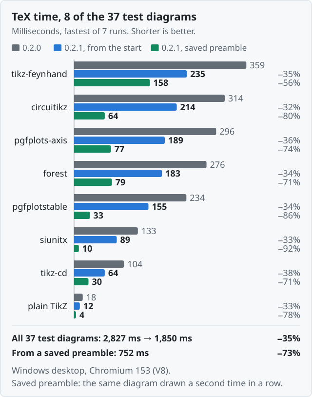
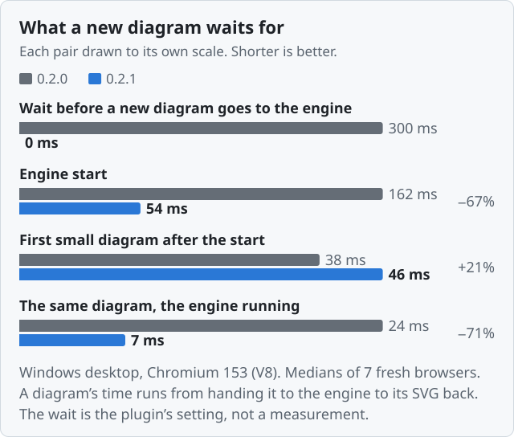
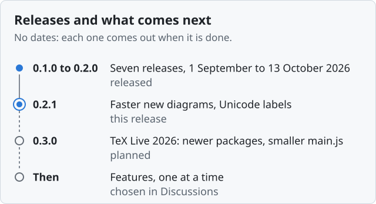

# TikZJax Next

Draw TikZ and LaTeX diagrams in Obsidian notes: write the code in a `tikz` block and the note shows
the picture. pgfplots, circuitikz, chemfig, tikz-cd, forest and a hundred TikZ and pgfplots
libraries are built in. TeX runs inside the plugin, compiled to WebAssembly, so there is nothing
else to install, nothing is uploaded and nothing is fetched. It works offline, on desktop, iPhone
and iPad, and needs Obsidian 1.7.2 or later.

It is a fork of [artisticat1/obsidian-tikzjax](https://github.com/artisticat1/obsidian-tikzjax),
which had not been updated since 2022. Version 0.2.1 sends a new diagram to the engine as soon as
it comes into view, takes about a third off TeX's time on a desktop, and lets a diagram skip a
preamble an earlier diagram has already compiled. Labels in Chinese, Greek, Cyrillic and other
scripts are drawn as well.

<!-- IPHONE-FIGURES: once 0.2.1's phone figures exist (see the marker under "## 0.2.1"), add here in one clause what 0.2.1 does on an iPhone, with the device named there. Until then this paragraph speaks only of the desktop. -->

<div align="center">

[](https://github.com/JackVinati/tikzjax-next/releases/latest)
[](https://github.com/JackVinati/tikzjax-next/actions/workflows/ci.yml)
[](https://obsidian.md/plugins?id=tikzjax-next)

</div>

````markdown
```tikz
\begin{tikzpicture}
  \draw (0,0) circle (1cm);
  \node at (0,-1.6) {hello};
\end{tikzpicture}
```
````

<div align="center">


Five of the plugin's test diagrams, as 0.2.1 draws them.

</div>

## 0.2.1

<div align="center">



</div>

Grey is 0.2.0. Blue is 0.2.1 compiling the diagram from the start, as it does the first time it sees
a preamble. Green is 0.2.1 drawing the same diagram a second time in a row, when it starts from the
preamble it saved the first time. In Chromium, over the 37 test diagrams 0.2.0 was released with,
TeX's time went from 2,827 ms to 1,850 ms from the start, 35% less, and each diagram took between
29% and 63% less. From a saved preamble the 37 took 752 ms. In WebKit, the browser engine of the
iPhone and iPad, run on the same desktop, the same sums went from 4,210 ms to 2,772 ms, each diagram
taking between 25% and 54% less, and to 1,192 ms from a saved preamble.

I measured this on my Windows desktop, in headless Chromium 153, which is what Obsidian's desktop
app is built on, and WebKit 26.6, through Playwright rather than inside Obsidian, with 0.2.0's
`main.js` as released beside 0.2.1's. Each figure is the fastest of seven runs, each run in a fresh
browser. Every test diagram 0.2.0 had draws as it did then, byte for byte, which CI checks; what
draws differently is labels in other scripts, which 0.2.0 left out, and the two fixes below.

The gain from the start is the engine. It is compiled so that TeX keeps the values it works on where
the processor reaches them directly, rather than in its memory; it is optimised with a newer
binaryen; and TeX's calls into the plugin, for every line and character it reads or prints, no
longer make new arrays each time. The gain from a saved preamble is that TeX does not load the
packages again: a diagram whose text up to `\begin{document}` is the same as an earlier diagram's
starts where that one stood at that point (see [Questions](#questions)).

<details>
<summary>All 37 test diagrams, in Chromium</summary>

<table>
<thead><tr><th>Test diagram</th><th>0.2.0 (ms)</th><th>0.2.1, from the start (ms)</th><th>0.2.1, saved preamble (ms)</th><th>Change from the start</th></tr></thead>
<tbody>
<tr><td><code>arrows-meta</code></td><td align="right">44</td><td align="right">28</td><td align="right">6</td><td align="right">−36%</td></tr>
<tr><td><code>basic</code> (plain TikZ)</td><td align="right">18</td><td align="right">12</td><td align="right">4</td><td align="right">−33%</td></tr>
<tr><td><code>batchmode-errors</code></td><td align="right">27</td><td align="right">10</td><td align="right">2</td><td align="right">−63%</td></tr>
<tr><td><code>batchmode-missing-file</code></td><td align="right">12</td><td align="right">8</td><td align="right">0</td><td align="right">−33%</td></tr>
<tr><td><code>broken</code> (an error on purpose)</td><td align="right">14</td><td align="right">9</td><td align="right">2</td><td align="right">−36%</td></tr>
<tr><td><code>chemfig</code></td><td align="right">64</td><td align="right">45</td><td align="right">17</td><td align="right">−30%</td></tr>
<tr><td><code>circuitikz</code></td><td align="right">314</td><td align="right">214</td><td align="right">64</td><td align="right">−32%</td></tr>
<tr><td><code>dieresis</code></td><td align="right">23</td><td align="right">14</td><td align="right">6</td><td align="right">−39%</td></tr>
<tr><td><code>documentclass</code></td><td align="right">14</td><td align="right">9</td><td align="right">2</td><td align="right">−36%</td></tr>
<tr><td><code>expl3</code></td><td align="right">18</td><td align="right">12</td><td align="right">3</td><td align="right">−33%</td></tr>
<tr><td><code>fatal-after-page</code></td><td align="right">14</td><td align="right">9</td><td align="right">2</td><td align="right">−36%</td></tr>
<tr><td><code>feynhand</code></td><td align="right">359</td><td align="right">235</td><td align="right">158</td><td align="right">−35%</td></tr>
<tr><td><code>filesize</code></td><td align="right">20</td><td align="right">11</td><td align="right">3</td><td align="right">−45%</td></tr>
<tr><td><code>forest</code></td><td align="right">276</td><td align="right">183</td><td align="right">79</td><td align="right">−34%</td></tr>
<tr><td><code>l-stroke</code></td><td align="right">21</td><td align="right">13</td><td align="right">5</td><td align="right">−38%</td></tr>
<tr><td><code>mathfrak</code></td><td align="right">20</td><td align="right">13</td><td align="right">4</td><td align="right">−35%</td></tr>
<tr><td><code>mathscr</code></td><td align="right">19</td><td align="right">12</td><td align="right">4</td><td align="right">−37%</td></tr>
<tr><td><code>mathtools</code></td><td align="right">48</td><td align="right">32</td><td align="right">4</td><td align="right">−33%</td></tr>
<tr><td><code>missing-package</code></td><td align="right">15</td><td align="right">10</td><td align="right">2</td><td align="right">−33%</td></tr>
<tr><td><code>missing-pgfplots-library</code></td><td align="right">167</td><td align="right">114</td><td align="right">104</td><td align="right">−32%</td></tr>
<tr><td><code>omega-otimes</code></td><td align="right">16</td><td align="right">11</td><td align="right">3</td><td align="right">−31%</td></tr>
<tr><td><code>patterns</code></td><td align="right">42</td><td align="right">26</td><td align="right">3</td><td align="right">−38%</td></tr>
<tr><td><code>pgfplots-axis</code></td><td align="right">296</td><td align="right">189</td><td align="right">77</td><td align="right">−36%</td></tr>
<tr><td><code>pgfplots-fillbetween</code></td><td align="right">292</td><td align="right">192</td><td align="right">72</td><td align="right">−34%</td></tr>
<tr><td><code>pgfplotstable</code></td><td align="right">234</td><td align="right">155</td><td align="right">33</td><td align="right">−34%</td></tr>
<tr><td><code>rule-frac</code></td><td align="right">20</td><td align="right">12</td><td align="right">5</td><td align="right">−40%</td></tr>
<tr><td><code>runaway-macro</code></td><td align="right">12</td><td align="right">8</td><td align="right">1</td><td align="right">−33%</td></tr>
<tr><td><code>shading</code></td><td align="right">22</td><td align="right">14</td><td align="right">7</td><td align="right">−36%</td></tr>
<tr><td><code>siunitx</code></td><td align="right">133</td><td align="right">89</td><td align="right">10</td><td align="right">−33%</td></tr>
<tr><td><code>tikz-cd</code></td><td align="right">104</td><td align="right">64</td><td align="right">30</td><td align="right">−38%</td></tr>
<tr><td><code>tilde</code></td><td align="right">19</td><td align="right">12</td><td align="right">5</td><td align="right">−37%</td></tr>
<tr><td><code>ts1-currency</code></td><td align="right">25</td><td align="right">16</td><td align="right">8</td><td align="right">−36%</td></tr>
<tr><td><code>ts1-small-caps</code></td><td align="right">22</td><td align="right">14</td><td align="right">6</td><td align="right">−36%</td></tr>
<tr><td><code>ts1-symbols</code></td><td align="right">23</td><td align="right">15</td><td align="right">7</td><td align="right">−35%</td></tr>
<tr><td><code>utf8-names</code></td><td align="right">22</td><td align="right">14</td><td align="right">6</td><td align="right">−36%</td></tr>
<tr><td><code>white-fill</code></td><td align="right">17</td><td align="right">12</td><td align="right">4</td><td align="right">−29%</td></tr>
<tr><td><code>xparse</code></td><td align="right">21</td><td align="right">14</td><td align="right">4</td><td align="right">−33%</td></tr>
<tr><td>All 37</td><td align="right">2,827</td><td align="right">1,850</td><td align="right">752</td><td align="right">−35%</td></tr>
</tbody>
</table>

TeX's time only, fastest of seven runs, in milliseconds. `missing-pgfplots-library` stops in its
preamble, so it saves nothing to start from.

</details>

A new diagram also waits before TeX starts on it: for the plugin to hand it to the engine, and for
the engine to start.

<div align="center">



</div>

In 0.2.0 a diagram that was not cached waited 300 ms on a computer, and 500 ms on a phone, before it
went to the engine, so that typing in a diagram would not compile it at every keystroke. It waited
also when you had just opened the note. 0.2.1 keeps that wait only for a note you are typing in. The
engine starts in a third of the time, and as soon as a diagram turns out not to be cached rather
than when it is about to be compiled. The first diagram after the engine starts takes a few
milliseconds longer than in 0.2.0, because it saves its preamble for the diagrams after it. Added
up, the first new diagram of a session spent about 500 ms on these three in 0.2.0 and about 100 ms
in 0.2.1, before the plugin's SVG pipeline and drawing it in the note, which this harness does not
include. After it, a small diagram with the same preamble takes 7 ms instead of 24, because it
starts from the saved preamble, and 14 with saved preambles off; the harness timed the same diagram
drawn a second time. The wait is the plugin's setting; the other figures are medians of the same
seven runs, in Chromium, and a diagram's time runs from handing it to the engine to its SVG back.

On my iPhone 16 Pro, on iOS 27.0.1 with Obsidian 1.14.5, 0.2.0's engine started in 134 ms and a
small diagram took 15 to 40 ms of TeX after the 500 ms wait, read off the diagnostics view on 14
October 2026. I will add 0.2.1's figures from the same phone here once I have read them off it the
same way; until then, every figure on this page that compares 0.2.1 with 0.2.0 is from the desktop.

<!-- IPHONE-FIGURES: 0.2.1 on the maintainer's iPhone. When the readings are in: fill the null entries of `texTimeIphone` and `wait.iphone` in scripts/readme-charts.mjs (each 0.2.1 value and `date021`), run `node scripts/readme-charts.mjs`, and add the two charts it then writes, docs/images/new-diagram-iphone-0.2.1.svg and docs/images/tex-time-iphone-0.2.1.svg, here, each as an  inside <div align="center"> like the desktop ones, with alt text that gives its figures. Then replace "I will add 0.2.1's figures ... is from the desktop." with a sentence giving them, with the device, iOS version, Obsidian version and date, say in the introduction at the top what 0.2.1 does there, and in Platforms add the build that was read to "0.2.1's betas, from beta.2 to beta.4". -->

Also in 0.2.1:

- Labels in Chinese, Japanese, Korean, Greek, Cyrillic, Arabic, Hebrew, Thai, Devanagari, IPA and
  emoji are drawn, where 0.2.0 left them out with an error. The engine has no fonts for them, so TeX
  sets each character as a box one em wide and the plugin writes the character over it in your
  system's sans-serif font; nodes and arrows are placed around it as around any other text, and in a
  `text width` node Chinese and Japanese wrap between characters. What text drawn this way cannot do
  is under [Known limitations](#known-limitations). RepentStar contributed it, in
  [pull request #2](https://github.com/JackVinati/tikzjax-next/pull/2).
- Saved preambles are also kept in this device's own storage, never in the vault, so after Obsidian
  restarts, or on a phone after the app was in the background, a diagram whose preamble is stored
  still starts from it ([Questions](#stored-preambles) has more).
- On a computer, two diagrams compile at once, each in an engine of its own, when several new ones
  are waiting. A note of 37 new diagrams handed over at once took 46 to 47% less time with two
  engines than with one, on the same desktop; a note you scroll through one diagram at a time gains
  less. Phones and tablets keep one engine.
- The diagnostics view shows each diagram's time from coming into view to drawn, every engine start,
  whether TeX runs with the JIT compiler, and whether a diagram started from a saved preamble. Its
  Copy button copies that as text for a bug report, without your diagrams' code or the names of your
  notes.
- There are two new settings, both on by default: Second engine, on a computer, and Saved preambles,
  on any device.
- Where TeX seems to run without the JIT, as with Lockdown Mode on, the diagnostics view says so,
  and a notice says it once ([below](#lockdown-mode)).
- Where Obsidian Sync left an old `main.js` beside a new `manifest.json`, the plugin says so once,
  from 0.2.1 on ([below](#out-of-step)).
- The engine keeps one block of memory for TeX instead of taking a new one for every diagram. Over a
  run of 85 diagrams on the same desktop, the most memory the page had in use at once went from 318
  to 278 MiB in Chromium and from 643 to 453 MiB in WebKit. Right after the last diagram, WebKit
  held more than with 0.2.0, 405 MiB against 226, because the engine keeps its memory and its saved
  preambles until it stops: after 15 seconds without a diagram on a phone, and five minutes on a
  computer.
- A preamble file that ends with a comment and no newline no longer breaks every diagram under it
  with "Missing \begin{document}", and a diagram that writes a file named like a bundled font's
  metrics no longer breaks that font for the diagrams after it.

After updating from 0.2.0, only the diagrams with a character the engine has no font for, such as
Chinese, Greek or Cyrillic, and those under a preamble file that ends with a comment and no newline,
are compiled again; every other diagram comes from the cache as before. Everything that changed is
in the [changelog](CHANGELOG.md).

## Installing

In Obsidian 1.7.2 or later: Settings → Community plugins → Browse, search for **TikZJax Next**,
install, enable.

To install by hand instead, download `main.js`, `manifest.json` and `styles.css` from a
[release](https://github.com/JackVinati/tikzjax-next/releases) into
`<vault>/.obsidian/plugins/tikzjax-next/` and enable it in Settings.

Disable the original TikZJax plugin first if you have it. The two have different plugin ids, so
they can be installed side by side, but both register the `tikz` code block and would render every
diagram twice. This plugin checks for that and refuses to start rather than doing it quietly.

If you had the original installed, its rendered diagrams are reused instead of being recompiled.
Its cache is only read, never modified, so it keeps working if you go back to it.

## Writing diagrams

A `tikz` block holds what a LaTeX file would, minus the `\documentclass` line: the engine starts
from the `standalone` class with TikZ and `xcolor` already loaded, and a second class is an error. A
block that is only a `tikzpicture` is wrapped in `\begin{document}` … `\end{document}` for you.

To load packages or libraries, write them the way a LaTeX file would, ahead of an explicit
`\begin{document}`:

````markdown
```tikz
\usepackage{pgfplots}
\pgfplotsset{compat=1.18}
\usepgfplotslibrary{fillbetween}
\begin{document}
\begin{tikzpicture}
  \begin{axis}[width=8cm, height=5cm]
    \addplot[name path=a, domain=0:3] {x};
    \addplot[name path=b, domain=0:3] {0.5*x^2};
    \addplot[gray!40] fill between[of=a and b];
  \end{axis}
\end{tikzpicture}
\end{document}
```
````

…or name them in a `%!tikz` line (below) and keep the block to the picture. A diagram renders when
it scrolls into view; one you have seen before appears instantly, from the cache, in the same frame
as the text around it. When TeX reports an error, the block shows it with its line (or, for an
error in a preamble file, that file and its line) and, where it can, what to change; a mistyped
macro usually still renders the rest of the diagram.

Accented letters work as typed, dieresis and `Ł` included (Grüße, naïve, `\"u`, Łódź), also in node
names, style names and `\label` keys. So do `°` `×` `±` `µ` `→` `£` `€` `©` `®`, `\$`, list bullets
and siunitx's units; see the limitations below for the characters that do not.
[`test/vault/TikZ-smoke-test.md`](test/vault/TikZ-smoke-test.md) is a note full of examples to copy
from.

## Per-block options

Options go in the block body, as `%!tikz` lines. They are stripped before the source reaches TeX.

````markdown
```tikz
%!tikz width=420 align=left colors=paper alt="RC low-pass filter"
%!tikz packages=circuitikz libraries=arrows.meta
\begin{circuitikz}
  \draw (0,0) to[R=$R$] (2,0) to[C=$C$] (2,-2) -- (0,-2) -- (0,0);
\end{circuitikz}
```
````

| Key | Values |
| --- | --- |
| `width`, `max-width`, `scale` | CSS length, or a number for `scale` |
| `align` | `left`, `center`, `right` |
| `alt` | quoted text, used as the accessible name. `alt=""` marks a diagram decorative |
| `colors` | `adapt` (default), `preserve`, `paper`, `invert` |
| `lazy` | `on`, `off`, `manual` |
| `timeout` | seconds, or a duration such as `500ms` |
| `packages` | comma list, `name[options]` accepted |
| `libraries` | comma list, passed to `\usetikzlibrary` |
| `border` | a TeX length, adds a margin around the diagram |
| `preamble` | a `.tex` file in the vault, put in front of the block. See below |
| `twopass` | runs TeX a second time when the first run left something to re-read, so `\label` and `\ref` resolve. Off by default: it can double the compile time |
| `wrap` | `auto` (default) wraps the block in `\begin{document}` … `\end{document}` unless it has one; `always` and `never` decide for it |
| `fast` | skips SVG optimisation and the pre-flight check, and renders ahead of other diagrams |
| `svgo` | `off` leaves the engine's SVG as it is; `targeted` and the default `preset` simplify how text is placed and drop an attribute browsers disagree on |
| `raw` | runs only the mandatory pipeline stages |
| `nocache` | skips the cache in both directions |

They are not written in the code fence line (` ```tikz width=420 `). Obsidian cannot read the fence
tail during PDF export, in embeds or in hover previews, so the same block would hash to two
different cache keys and the PDF would get a differently compiled diagram.

The plugin's settings cover colours, lazy rendering, fast mode, a second engine on a computer, saved
preambles, the time limit, how the source is cleaned up, the pre-flight checks, the preamble files,
the TeX log and the cache. A change applies to the open notes straight away, also when it arrives
from another device through Sync. Where an option shares its name with a setting (`colors`, `lazy`,
`timeout`, `fast`) the option wins for its block.

## Shared preambles

Macros, styles and packages that many diagrams use can live in a `.tex` file in the vault instead
of being repeated in every block. A preamble goes where a LaTeX preamble goes, before
`\begin{document}`, so it holds `\usepackage`, `\usetikzlibrary`, `\newcommand`, `\tikzset` and
`\pgfplotsset`.

`latex/diagrams.tex`:

```tex
\usetikzlibrary{arrows.meta, positioning}
\tikzset{box/.style={draw, rounded corners, inner sep=6pt}}
\newcommand{\vect}[1]{\mathbf{#1}}
```

A note:

````markdown
```tikz
%:input latex/diagrams.tex
\begin{tikzpicture}
  \node[box] (f) {$f(\vect{x}) = A\vect{x}$};
  \node[box, right=of f] (g) {$g$};
  \draw[-Stealth] (f) -- (g);
\end{tikzpicture}
```
````

Four things can name a preamble file. Every one that applies is used, in this order, so a later
file can use what an earlier one defines:

1. **The vault-wide preamble**: Settings → Preamble → Preamble file, a path in the vault. The field
   suggests the vault's `.tex`, `.sty`, `.ltx`, `.def` and `.txt` files as you type; the path takes
   effect when you pick one, press Enter or leave the field.
2. **A folder preamble**: a file named `tikz-preamble.tex` in the note's folder, or failing that the
   nearest folder above it, up to the root of the vault. Only the nearest one is used. The name is
   Settings → Preamble → Folder preamble file name, which takes effect the same way; empty turns
   the search off.
3. **`%!tikz preamble=path/to/file.tex`** in the block.
4. **`%:input path/to/file.tex`** lines in the block, in the order they are written. A preamble file
   can `%:input` other files as well.

Paths resolve the way a `[[link]]` does: relative to the file that wrote them (the note, or the
preamble file for a nested `%:input`) and otherwise by name anywhere in the vault. A file named
twice is included once. A file that cannot be found, or a loop of `%:input`s, shows a note under the
diagram saying which file and who asked for it; nothing is silently left out. Inside a preamble file
only `%:input` lines are read as directives: a `%!tikz` line there is a TeX comment and changes
nothing.

The contents of every preamble file are part of the cache key of each diagram that uses it. Edit
the file and those diagrams, and only those, are compiled again the next time they render; a stale
one is never served from the cache. Open notes re-render straight away, in Reading view and in Live
Preview. When TeX stops on a line of a preamble file, the error card names the file and the line.

## Commands

| Command | What it does |
| --- | --- |
| Copy the diagram at the cursor as SVG | Puts the rendered SVG on the clipboard, theme-neutral, so it opens correctly outside Obsidian. |
| Save the diagram at the cursor as an SVG file | Writes it to your attachment folder. |
| Finalize the diagrams in this note | Saves each diagram as an attachment and rewrites the note as `![[diagram.svg]]` with the original fence preserved verbatim inside an Obsidian `%%` comment. The point is that the note now renders without this plugin: in Publish, in another editor, on GitHub. |
| Un-finalize the diagrams in this note | The exact inverse. The source was never thrown away. |
| Render all diagrams in this note | Ignores lazy rendering and compiles everything now, with a Stop button, and says how many rendered. |
| Open the diagram at the cursor in a zoom view | A scrollable, zoomable view of one diagram. |
| Open TikZ diagnostics | The engine, the cache, and each recent diagram: how it came out, where its time went from coming into view to drawn, and how often the engine started. Its Copy button copies the versions, the device, the engine's starts and the timings as text for a bug report, without your diagrams' code, their error messages or the names of your notes. Start here when a diagram does something inexplicable. |
| Clear the diagram cache | Forgets every diagram this plugin has rendered, and deletes the [stored preambles](#stored-preambles); each diagram compiles again when it is next shown. |
| Restart the TeX engine | Stops the engine, which starts again with the next diagram, and lets diagrams that failed in this session try again. The next start picks up the stored preambles again: should a preamble draw wrongly, turn off Settings → Saved preambles instead. |

The commands about the diagram at the cursor, and Finalize and Un-finalize, need the note open in
the editor, in Live Preview or Source mode; they are not offered in Reading view. Finalize leaves
alone a diagram in a blockquote or a callout, and one whose fence starts on the list item's own
line (`1. ```tikz`); copy or save those as SVG instead.

## What is bundled

The engine is e-TeX with a LaTeX format, built from TeX Live 2023 as Ubuntu 24.04 packages it.
The main packages, with the versions the engine reports (Settings → Bundled TeX engine shows them
for the installed build):

| Package | Version |
| --- | --- |
| pgf/TikZ | 3.1.10 |
| pgfplots, pgfplotstable | 1.18.1 |
| circuitikz | 1.6.6 |
| chemfig | 1.66 |
| siunitx | 3.3.10 |
| tikz-cd | 1.0 |
| amsmath | 2.17o |
| expl3 | 2024-01-22 |
| xparse | 2023-10-10 |
| standalone class | 1.3b |

0.2.0 and 0.2.1 change the engine, not the packages: these are the versions 0.1.5 had. Newer ones
come with TeX Live 2026 in 0.3.0.

Loaded before your block starts: the `standalone` class, `tikz` (with `pgf`) and `xcolor`. Besides
those, there are 42 packages (counting the ones the others load), 84 TikZ libraries and 16 pgfplots
libraries, from 247 TeX files. The lists below are taken from the build itself, and a test keeps
them in step with it.

**Packages**, for `\usepackage` or `%!tikz packages=`, including the ones the others load:
<!-- bundled:packages -->
`amsbsy` `amsfonts` `amsgen` `amsmath` `amsopn` `amssymb` `amstext` `array` `atveryend`
`atveryend-ltx` `calc` `chemfig` `circuitikz` `color` `elocalloc` `environ` `etoolbox` `eufrak`
`expl3` `forest` `hf-tikz` `ifthen` `infwarerr` `inlinedef` `keyval` `ltxcmds` `mathrsfs`
`mathtools` `mhsetup` `pdftexcmds` `pgfcalendar` `pgfopts` `pgfplots` `pgfplotstable` `preview`
`siunitx` `tikz-3dplot` `tikz-cd` `tikz-feynhand` `translations` `trimspaces` `xparse`
<!-- /bundled:packages -->

**TikZ libraries**, for `\usetikzlibrary` or `%!tikz libraries=`:
<!-- bundled:tikz-libraries -->
`3d` `angles` `animations` `arrows` `arrows.meta` `automata` `babel` `backgrounds` `bbox` `bending`
`calc` `calendar` `cd` `chains` `circuits` `circuits.ee` `circuits.ee.IEC` `circuits.logic`
`circuits.logic.CDH` `circuits.logic.IEC` `circuits.logic.US` `curvilinear` `datavisualization`
`datavisualization.3d` `datavisualization.barcharts` `datavisualization.formats.functions`
`datavisualization.polar` `datavisualization.sparklines` `decorations` `decorations.footprints`
`decorations.fractals` `decorations.markings` `decorations.pathmorphing`
`decorations.pathreplacing` `decorations.shapes` `decorations.softclip` `decorations.text` `er`
`external` `fadings` `feynhand` `fillbetween` `fit` `fixedpointarithmetic` `folding` `fpu`
`graphs` `graphs.standard` `intersections` `lindenmayersystems` `math` `matrix` `mindmap`
`patterns` `patterns.meta` `perspective` `petri` `plothandlers` `plotmarks` `positioning` `quotes`
`rdf` `scopes` `shadings` `shadows` `shapes` `shapes.arrows` `shapes.callouts` `shapes.gates.ee`
`shapes.gates.ee.IEC` `shapes.gates.logic` `shapes.gates.logic.IEC` `shapes.gates.logic.US`
`shapes.geometric` `shapes.misc` `shapes.multipart` `shapes.symbols` `snakes` `spy` `svg.path`
`through` `trees` `turtle` `views`
<!-- /bundled:tikz-libraries -->

**pgfplots libraries**, for `\usepgfplotslibrary`:
<!-- bundled:pgfplots-libraries -->
`clickable` `colorbrewer` `colormaps` `colortol` `contourlua` `dateplot` `decorations.softclip`
`fillbetween` `groupplots` `patchplots` `polar` `smithchart` `statistics` `surfshading` `ternary`
`units`
<!-- /bundled:pgfplots-libraries -->

Being in the list means the file is there, not that everything in it can work: `contourlua` needs
LuaTeX and `external` needs to run programs, and this engine has neither. What a fixture in
`test/fixtures/tex` renders end to end through the shipped worker, on every CI run: plain TikZ,
`pgfplots` including its libraries, `pgfplotstable`, `circuitikz`, `chemfig`, `tikz-cd`, `forest`,
`mathtools`, `xparse`, `siunitx`, `tikz-feynhand`, `arrows.meta`, shadings, `~`, letters with a
dieresis, `Ł` and `ł`, accented node and style names (`(café)`, `grün`), `°` `×` `→` `±` `µ`
`£` `€` `$` `©` `®` `ª` `º` with their text commands, labels in Chinese, Greek and Cyrillic beside
node, style and colour names in them, and Chinese and Japanese wrapped in a `text width` node. The
`patterns` library loads too, but see the limitations below.

## Known limitations

| | |
| --- | --- |
| `\mathfrak`, `\mathscr` | TeX compiles them, and then the diagram fails: the DVI-to-SVG converter has a fixed font table, and it has neither the Euler fonts nor rsfs. For `\mathfrak` the Euler face and its metrics both ship, so the fix is in `@drgrice1/dvi2html`. `\mathscr` (rsfs) has only its metrics bundled and no face at all, so it would need a face built as well as a converter change. |
| `patterns` draws nothing | The driver emits the pattern reference but not the pattern definition. |
| `chemfig`'s `\schemestart` loses bonds | The bonds are already missing in the DVI, before any JavaScript runs. |
| `tikz-feynman` | LuaTeX only. `tikz-feynhand` is bundled and works. |
| Greek, Cyrillic, CJK, Arabic, Hebrew, IPA, emoji | Not in this engine's fonts, so TeX sets each such character in a label as a box one em wide, and the plugin writes it over the box in your system's sans-serif font. It renders, but not in Computer Modern. Most accented Latin letters are typeset by TeX itself (Dvořák, Erdős, İstanbul, Łódź, café, Grüße, naïve), as are curly quotes, dashes and `…`; the exact set is measured from the engine and listed in `src/source/native-unicode.ts`. Nodes, coordinates, styles, colours and `\label`s can be named in any script. In typewriter type `Ł` and `ł` show a `␣` where the stroke should be, because that font has one in its place. |
| `\textyen`, `\textperthousand`, `\textcircled` and the rest of TS1 | They come from the TS1 text companion font, which the SVG converter cannot draw, and the diagram fails. Typed as `¥` `¢` `‰` `½` `№`, those characters are drawn in sans-serif like the scripts above. `°` `×` `±` `µ` `·` `÷` `¬` `§` `¶` `†` `‡` `•` `™` `℃` `←` `↑` `→` `↓` `Ω` and `²` `³` `¹`, their `\text…` commands, siunitx's units (`\degree`, `\micro`, `\ohm` and the rest), `\S`, `\dag` and list bullets do render: they are drawn from the math fonts instead, so `µ` comes out as the italic math `μ`. So do `£` `€` `©` `®` `ª` `º`, their `\text…` commands, `\pounds`, `\copyright` and `\$`, built from the Computer Modern text fonts, mostly as older LaTeX releases built them: `€` is a C with a small `=` across it, LaTeX's own stand-in for a font without a euro, and in bold type `£` and `®` stay medium weight. |
| Text drawn in sans-serif | It sits in the space TeX set aside, one em for each character, so a word in Cyrillic or Greek takes more room than it needs, and a long one can stick out of a narrow `text width` node. In a `text width` node or a `\parbox`, a line breaks where a space is typed, and Chinese and Japanese also between two characters, though not before closing punctuation or a small kana, nor after an opening bracket. It keeps the size and colour TeX gave it, but not bold or italic, and in a sub- or superscript it is full size. In maths, a typed `α` `∈` `∞` is drawn the same way, upright; TeX's own `$\alpha$` `$\in$` `$\infty$` give Computer Modern's. Characters set side by side, or with only spaces between them, are drawn as one piece of text, so a phrase in Arabic or Hebrew reads in the right order, unless a number or a Latin word in it splits it. An accent typed as a separate combining character after its letter is drawn beside it, so type the accented letter itself. With Source handling at Corrected, the default, the plugin removes invisible characters from every block, the zero-width joiner and non-joiner among them: an emoji built with joiners comes out as its parts, and a Persian, Urdu or Indic word spelled with a non-joiner is joined where it should not be. Text outside the picture, such as `\chemname`'s name under a molecule, is not drawn. |
| Sans-serif text in a copied or saved SVG | The SVG names the font `sans-serif` and does not embed it, so another program draws that text in its own. |
| Obsidian Sync Standard does not sync `main.js` | It is 12.2 MB (11.7 MiB), and that plan caps a file at 5 MB. The plugin still installs from the community browser or a release on every device; only syncing the plugin folder itself is affected. The size is the TeX engine (the 22 MiB of its 156 MiB core dump that holds anything, gzipped and base64'd), and shrinking it means a smaller engine, not tighter code. TeX Live 2026 in 0.3.0 should bring it to about 8.3 MB, still over the limit. |
| Obsidian Publish | Publish runs no community plugins. Save the diagram as an SVG attachment, or finalize the note, and the result publishes as ordinary content. |

## Platforms

| Platform | State |
| --- | --- |
| Windows, macOS, Linux | Works on Windows, which is what I use and where every desktop figure above was measured. macOS and Linux run the same code, but I have not tried them. |
| iPhone and iPad | Works: the engine compiles and diagrams render on the device, as checked on an iPhone (below). It is slower than on a desktop, and the first diagram that is not cached is the slowest, because it starts the engine. |
| Android | Not tried yet. A report either way is welcome, in [Q&A](https://github.com/JackVinati/tikzjax-next/discussions/categories/q-a) or as an issue. |

My iPhone is an iPhone 16 Pro on iOS 27.0.1, with Obsidian 1.14.5. On it I have checked that 0.1.5
and 0.2.0 load and render and that Settings opens, and with 0.1.5 that a diagram still compiling
when you switch away from the app finishes when you come back, instead of failing with a timeout.
0.2.1's betas, from beta.2 to beta.4, load and render on it too, and the diagnostics view's Copy
button copies its text. The phone figures on this page are read off that view. With 0.2.0 I also
timed diagrams with Lockdown Mode on and off ([Questions](#lockdown-mode)). The iPad runs the same
build; I have not checked it separately. 0.2.1's engine uses only WebAssembly 1.0, as 0.2.0's did,
so it compiles in the same WebViews as before, iOS 14.5's among them; a check in CI decodes the
engine to make sure. Before iOS 16.4, which has no decompression of its own for the engine to use,
the engine unpacks itself in JavaScript, as 0.2.0 did.

<!-- DEVICE-CHECK: still to try on a phone: a note with twenty diagrams that are not cached, scrolling it, and a PDF export; and anything on an iPad. When they are done, replace "The iPad runs the same build; I have not checked it separately." with what was checked on it, and drop from "Not tried there yet" whatever has now been tried. -->

Not tried there yet: a note with twenty diagrams that are not cached, and PDF export on the phone.
If something gives out on a phone, it is probably one of those, and an issue with the device, the iOS
version and the text the diagnostics view's Copy button gives helps more than anything else.
[Questions](#questions) explains how to get that text, and then the console output from an iPhone
with Safari on a Mac.

## Tests

Every push to main, every pull request and every release runs the same checks: over 1,400 unit
tests, the community store's lint rules, type checks with two versions of TypeScript, a check that
the plugin makes no network requests, and all 44 TeX test diagrams through the real engine. Each
has to give, byte for byte, the DVI, transcript and SVG recorded for it (or, where none was
recorded, none), so an engine change cannot alter any of them unnoticed. Each test diagram, and 33
cases written to break saved preambles, must also come out the same, byte for byte, when it starts
from a saved preamble, kept in memory or read back from storage, as when it is drawn from the start;
and the memory TeX is handed before each diagram must be the same as a new one. The build refuses
syntax that older iOS Safari cannot parse.

The plugin is built with TypeScript 7, esbuild 0.28, ESLint 10 and Vitest 5, against the Obsidian
1.14 typings, and Dependabot checks its dependencies every week.

Releases are reproducible: building the tagged commit gives the same `main.js` on any machine, and
the community store checks exactly that. A release runs all of CI again on the tag and is published
with build provenance attestations. The TeX engine is built in a container from pinned upstream
sources, and a weekly job rebuilds it and checks that it matches the copy in the repository.

## Roadmap

<div align="center">



</div>

0.1.0 came out on 1 September 2026, and 0.1.5 and 0.2.0 on 13 October. Every version goes through
the community store's review again, so I would rather put out fewer, bigger releases. The order can
change with what people ask for.

- **0.2.1: shorter waits for new diagrams.** This release: no wait before a new diagram goes to the
  engine, a third less time in TeX, saved preambles that later diagrams start from, kept across
  restarts, a second engine on a computer, and labels in other scripts (see [0.2.1](#021)).
- **0.3.0: TeX Live 2026.** Newer pgf/TikZ, pgfplots, circuitikz, chemfig and siunitx, which means
  new circuitikz components, chemfig's `\hreac` and three years of fixes. `main.js` should shrink
  from about 12.2 MB to about 8.3 MB, by an estimate from a test build. TeX itself will not get
  faster: in my tests, on the engine before 0.2.0, the total was a few percent slower and every
  small diagram 10 to 20 ms slower. The hash-table change in 0.2.0 wins back most of the total, but
  not the cost on small diagrams. With the new packages too, a diagram drawn from a saved preamble
  has to come out byte for byte as one drawn from the start, which CI checks.
- **After that, features one at a time**, chosen in Discussions: `![[file.tex]]` embeds rendered in
  place (planned, [issue #1](https://github.com/JackVinati/tikzjax-next/issues/1)), `.sty` and
  `.csv` files from the vault, Copy as PNG and syntax highlighting in `tikz` blocks. Labels in other
  scripts, which were on this list, came in 0.2.1, from
  [pull request #2](https://github.com/JackVinati/tikzjax-next/pull/2).

The plan in full is on the wiki's [Roadmap](https://github.com/JackVinati/tikzjax-next/wiki/Roadmap).
To ask for something, or vote for what is already there, use
[Discussions → Ideas](https://github.com/JackVinati/tikzjax-next/discussions/categories/ideas): a
thumbs-up counts as a vote.

## Questions

**Do I need LaTeX installed?** No. The whole engine is inside the plugin and runs offline.

**Why does the first diagram take a while?** It starts the engine. On my desktop, in headless
Chromium, the browser engine of Obsidian's desktop app, that takes about 54 ms with 0.2.1, where
0.2.0 took about 160 ms. On my iPhone 16 Pro, on iOS 27.0.1, 0.2.0's engine started in 134 ms, read
off the diagnostics view on 14 October 2026, with Obsidian excluded from Lockdown Mode (below). The
first diagram of each preamble also saves it, which costs it a few milliseconds and spares the
diagrams after it their packages. Later diagrams in the session are faster, and a diagram you have
already seen comes from the cache without running TeX at all.

<!-- IPHONE-FIGURES: the iPhone engine start above is one reading of 0.2.0 on the maintainer's iPhone 16 Pro (iOS 27.0.1, Obsidian 1.14.5, diagnostics view, 14 October 2026). Add 0.2.1's from the same phone once `wait.iphone` in scripts/readme-charts.mjs is filled in. -->

**Why is the second diagram with the same packages faster?** Since 0.2.1 the engine keeps where TeX
stands once a diagram's `\begin{document}` is done, with its packages and preamble loaded, and a
later diagram whose text is the same up to there starts from that point and compiles only its body.
"The same up to there" is everything the plugin puts in front of the block: the packages and
libraries in its `%!tikz` line or the settings, the global preamble, a preamble file, and the
block's own lines before `\begin{document}`. Blocks that are only a `tikzpicture` all share one,
except a block with a character drawn in sans-serif, or with one of the stand-ins for `°` `×` `£`
and the like: those add to what comes first, so they share one only with blocks that add the same.
On a Windows desktop, in headless Chromium and WebKit through Playwright rather than in Obsidian,
drawn a second time in a row, a plain TikZ diagram took 4 ms of TeX where it took 12 from the start
in Chromium, the engine of Obsidian's desktop app, and circuitikz 64 where it took 214; in WebKit,
the engine of the iPhone and iPad, 6 instead of 17 and 105 instead of 318. The first diagram of each
preamble takes a few milliseconds more, to save it, and about a tenth of a second without the JIT
(below). An engine keeps up to 32 MB of saved preambles in memory on a computer and 12 MB on a phone
or tablet, or on a computer that reports less than 8 GB of memory. In 12 MB a large preamble does
not always fit beside the ones in use, and is then not kept there. A diagram drawn this way is the
same, byte for byte, as one drawn from the start, and every release checks that for every test
diagram; a preamble that asks the size of the diagram's own file, or reads it, is never saved. The
diagnostics view says of each diagram whether it started from a saved preamble.

<a id="stored-preambles"></a>**Do saved preambles survive a restart?** Yes. The engine stops when it
has had nothing to do for a while, on a phone after 15 seconds and whenever Obsidian goes to the
background, and the preambles it holds in memory go with it. So each one is also kept in this
device's own storage, in Obsidian's IndexedDB beside the diagram cache: never in your vault or the
plugin's folder, so it is never synced with the vault, by Obsidian Sync or iCloud Drive, and each
device keeps its own. When the engine starts again, after a stop or after Obsidian restarts, a
diagram whose preamble is stored starts from it instead of loading its packages again. On a Windows
desktop, in headless WebKit with a phone's budgets rather than in Obsidian, the first diagram after
a fresh start of the browser, the engine's start included, took 223 ms for circuitikz from its
stored preamble where it took 426 with the preamble compiled, and 153 for pgfplotstable where it
took 358; without the JIT, circuitikz took 2.8 s instead of 8.2.

A stored preamble is where TeX stood once everything in front of a diagram's `\begin{document}` was
read: the packages and libraries, the global preamble, the folder's `tikz-preamble.tex`, any
`preamble=` or `%:input` file and, in a block with a `\begin{document}` of its own, the block's
lines before it, with their text as it was read, what TeX printed while reading them, and any file
it had written by then. The diagram itself is not in it. It is compressed where the system can, and
not encrypted, like the diagram cache. Stored preambles take up to 64 MB for each vault on a
computer, and 16 MB on a phone or tablet and on a computer that reports less than 8 GB of memory;
when that is full, the preamble used least recently goes, one that took longer to load counting as
used a little later, and until then one stays, also after you
edit a preamble file, whose new text is stored as another preamble. A stored preamble belongs to one
build of the engine, and an update with another one deletes a vault's old ones, unread, the next
time its engine starts. Clearing the diagram cache (Settings → TikZJax Next → Cached diagrams →
Clear, or the command) deletes them, and so does turning saved preambles off. Obsidian tells a
plugin nothing when it is disabled or uninstalled, so to remove them and the cached diagrams from a
device, clear the cache before you remove the plugin. Where storage is not available, as in some
private or restricted setups, preambles are kept only while the engine runs, as before; where it is
full, the ones stored are still used. The diagnostics view counts the storage errors, shows how many
preambles are stored and how much room they take, and says of a diagram that started from one
"resumed from a stored preamble", with how long reading it and putting it back took.

**How do I turn saved preambles off?** Should a diagram ever draw differently because of them, turn
off Settings → TikZJax Next → Saved preambles, on a phone as on a computer; from the next diagram
on, every diagram is compiled from the start, as in 0.2.0, and the preambles stored on that device
are deleted. Please open an issue with the diagram if that changes how it draws.

**Can I put TikZ in a `$$ … $$` math block?** No. Obsidian hands math blocks to MathJax before any
plugin sees them, and MathJax does not run TikZ. Use a `tikz` block; for an inline-looking result,
`%!tikz align=left` and a small `width`.

**My block starts with `\documentclass` and shows an error.** Remove the line. The engine already
has its document class loaded, so LaTeX reports a second one ("Two \documentclass or \documentstyle
commands"), and `\usepackage` lines followed by `\begin{document}` work as they would in a LaTeX
file.

**A plot of `tan`, `1/x` or `exp` fails with "Dimension too large".** pgfmath works in fixed point
and overflows near an asymptote or a large value, the same way it does in a real LaTeX
installation. Restrict the `domain`, or skip the region around the asymptote.

**Can I use `tikz-feynman`?** It needs LuaTeX, which this engine is not. `tikz-feynhand` is bundled:
it is derived from `tikz-feynman`, with the vertices placed by hand. `%!tikz packages=tikz-feynhand`.

**Is package X available?** See [What is bundled](#what-is-bundled). If it is not there, the
diagram tells you with LaTeX's ``File `X.sty' not found``. If the diagram never uses the package,
as with `inputenc` or `fontenc`, which are not needed here, nothing else changes and the line can
go. For a package you do need, open an issue with the package request form and a diagram that needs
it.

**Can I use the diagrams outside Obsidian?** Copy or save one as SVG with the commands above, or
finalize the note: each diagram becomes an SVG attachment and the source stays in the note, so it
shows up in Publish, on GitHub and in any Markdown editor.

**Something fails on my iPhone. How do I report it?** First run "Open TikZ diagnostics" from the
command palette, press Copy, and paste the text into the issue: it has the versions, the device,
the engine's starts and where each diagram's time went, and none of your diagrams' code or note
names. There are no devtools on the device, but after that, if you have a Mac, Safari can reach its
console: on the device, Settings → Apps → Safari → Advanced → Web Inspector; connect it to a Mac by
cable; then in Safari on the Mac, Develop → the device → the Obsidian window. Every mobile bug
report on the original repository is untriageable for want of this paragraph, so if you are filing
one, this is how to get something worth attaching.

<a id="lockdown-mode"></a>**Diagrams are very slow on my iPhone or iPad.** See whether Lockdown Mode
is on: Settings → Privacy & Security → Lockdown Mode. It runs Obsidian's web content without the JIT
compiler, and the TeX engine with it, which makes TeX twenty to thirty times slower. On my iPhone 16
Pro, on iOS 27.0.1 with 0.2.0, on 14 October 2026, a circuitikz diagram took 7.3 s of TeX with
Lockdown Mode on and 0.27 s with Obsidian excluded from it, 27 times as long, and the engine started
in 1.3 s instead of 0.13 s. Lockdown Mode can stay on for everything else: under Configure Web
Browsing in its settings you can exclude Obsidian alone, then restart Obsidian. The exclusion takes
Lockdown Mode's protection away from Obsidian's web content, so whether it is worth it is your call.
On some versions of iOS, Lockdown Mode turns WebAssembly off altogether: then the engine does not
start at all, the diagram's card says that the device runs no WebAssembly, and on some of those
versions excluding Obsidian has been reported not to bring it back.

Low Power Mode, a phone that is hot, and a nearly empty battery slow the whole phone down, the
plugin with everything else, though not by as much. On my iPhone 16 Pro, on iOS 27.0.1, in Low Power
Mode with the battery at 18% on 15 October 2026, 0.2.1-beta.4 took 867 ms of TeX for circuitikz and
749 for pgfplots, where beta.3 had taken 231 and 211 the day before; one reading each. The engine's
unpacking, which does not use the JIT, took more than three times as long too, so it was the phone
that was slow, and there was nothing to change in Obsidian.

The diagnostics view tells the two apart: run "Open TikZ diagnostics" from the command palette and
read its JIT line. "on (probably)" means TeX runs with the JIT, and a slow diagram is the phone
being slow. "off (probably)" means it runs without, most likely because of Lockdown Mode. "unclear"
means the engine's test could not tell, and "checking again" that it is taking the test once more, a
second after the engine started, so that a phone that is only slow is not taken for one without the
JIT. "no WebAssembly" means the engine cannot run at all. When two engine starts in a session find
the JIT off on an iPhone or iPad, a notice says so once.

<!-- IPHONE-FIGURES: the 7.3 s, 0.27 s, 1.3 s and 0.13 s above are one reading each of 0.2.0 on the maintainer's iPhone 16 Pro (iOS 27.0.1, Obsidian 1.14.5, diagnostics view, 14 October 2026). The Low Power Mode figures are his readings of 0.2.1-beta.4 on 15 October 2026 against 0.2.1-beta.3 on 14 October (internal/DECISIONS.md D38; the inflate took 86 ms against 26). Add 0.2.1's own figures with Lockdown Mode on, from TODO.md §9's JIT probe check, once they exist. -->

<a id="out-of-step"></a>**After an update, another device shows the new version but nothing changed.**
Obsidian Sync Standard does not copy a file over 5 MB, and `main.js` is about 12 MB. When Sync
carries your installed plugins, the other device gets the new `manifest.json`, which names the new
version, and keeps the old `main.js`; Obsidian and BRAT then see the new version number and offer
no update. With Sync Standard, turn off "Installed community plugins" in Sync's settings and update
the plugin on each device. To repair a device already in this state, reinstall the plugin there:
with BRAT, its "Choose a single plugin to reinstall"; from the community store, uninstall it and
install it again, which also resets its settings on that device. Since 0.2.1 a device in this state
says so once, and the diagnostics view shows both versions, but only when its `main.js` is 0.2.1
or later: 0.2.0's cannot tell.

**Where can I ask something, or suggest a feature?** In
[Discussions](https://github.com/JackVinati/tikzjax-next/discussions):
[Q&A](https://github.com/JackVinati/tikzjax-next/discussions/categories/q-a) for help with a
diagram, [Ideas](https://github.com/JackVinati/tikzjax-next/discussions/categories/ideas) for the
rest.

## Coming from the original TikZJax

The original plugin created a `<script type="text/tikz">` element and let a bundled script scan the
document for it. That meant it held no handle on anything it started, so per-diagram timeouts,
cancellation, caching, error reporting and PDF export were not so much unimplemented as
unreachable. This fork owns the whole path from the code fence to the SVG.

**Cached diagrams appear instantly.** A diagram you have seen before is a hash lookup and one string
replacement, done before the code block processor returns, so it paints in the same frame as the
surrounding text with no spinner and no layout shift. Diagrams are cached by a hash of their source,
so nothing recompiles unless you change it. Switching theme, resizing a diagram or changing its
alignment costs no recompilation at all, because none of those are part of the cache key.

**Errors say what went wrong.** The old plugin's only failure path was a broken-image icon (and an
HTTP request to a third-party domain on every failure, in a plugin whose selling point was working
offline). This one reports the TeX error and the line, and where possible what to do about it. A
mistyped macro usually renders the rest of the diagram and tells you what it dropped.

**A bad diagram cannot take the rest with it.** TeX is fed `\nonstopmode`, so an error is logged
instead of stopping at an interactive prompt. If a diagram exceeds its time budget the worker is
terminated and restarted, and only that diagram fails. In the original, one bad diagram blocked
every later one until Obsidian was restarted.

**Diagrams render when they scroll into view**, off the editor's thread: one at a time on a phone,
and two at a time on a computer while several are waiting, each in an engine of its own, unless the
second engine is turned off or the computer reports little memory. A note with thirty of them does
not lock up the editor.

**PDF export waits for the diagrams.** The processor returns a promise, which is what Obsidian
actually awaits before taking the print snapshot, for at most a minute in all, after which a diagram
not yet compiled is printed as a short note saying so; "Render all diagrams in this note"
beforehand makes sure there is none. Colours are pinned to black on white for print regardless of
your theme.

**Dark mode is handled in CSS, not by rewriting the SVG.** The old plugin string-replaced `black`
and `white` inside the markup, which could not tell TeX's default ink from a colour you chose, and
baked CSS variables into presentation attributes so a copied SVG rendered wrong outside Obsidian.
Here the stored diagram is theme-neutral and CSS does the work.

**The TeX engine is built from source**, in a container, from pinned upstream commits, rather than
vendored as an opaque 7 MB file. That is what made it possible to find out what is actually inside
it, and to fix things that were previously assumed to be immovable. 0.2.0 and 0.2.1 change that
build: asyncify taken out, TeX's macro names spread over more of its hash table, three files of
web2js's code generator replaced so that TeX's local variables are WebAssembly locals, and four TeX
change files of its own, one of them the point where a diagram's preamble is saved.

The JavaScript toolchain is current (see [Tests](#tests)), and that is the point of the fork rather
than a detail of it. The plugin still runs on Obsidian 1.7.2 and up, because the floor is set by the
API it actually calls rather than by the version it was written against. The TeX side is TeX Live
2023 until 0.3.0 brings TeX Live 2026.

For contrast, the state of the plugin this forks from: its lockfile no longer installed at all, and
its build config listed twenty-one `@codemirror` packages of which thirteen had been folded into
others years earlier.

## Contributing

```sh
npm ci
npm run build          # main.js and styles.css, in seconds, with no Docker
```

The compressed TeX engine is committed, so that is the whole build.
[CONTRIBUTING.md](CONTRIBUTING.md) has the checks CI runs, the rules a change has to keep, how to
rebuild the engine, and how releases are cut. Security problems go to [SECURITY.md](SECURITY.md)
rather than to a public issue. What changed in each release is in [CHANGELOG.md](CHANGELOG.md).

## Licence

GPL-3.0-or-later. The plugin embeds a TeX engine derived from
[drgrice1/tikzjax](https://github.com/drgrice1/tikzjax) and
[drgrice1/web2js](https://github.com/drgrice1/web2js), both GPL-3, so the combined work is too.

`NOTICE` lists every embedded component with its own terms: TeX itself, PGF/TikZ, pgfplots,
circuitikz, chemfig and every other bundled package, and the fonts, which are Basil K. Malyshev's
BaKoMa Type 1 conversions of Computer Modern and the AMS fonts, under the BaKoMa licence. Full
licence texts are in `vendor/LICENSES/`.

## Credits

Jim Fowler wrote [TikZJax](https://github.com/kisonecat/tikzjax) and
[web2js](https://github.com/kisonecat/web2js), which is the hard part and the reason any of this is
possible. Glenn Rice maintains the forks this engine is built from. artisticat1 wrote the original
Obsidian plugin. Basil K. Malyshev made the BaKoMa fonts every diagram is drawn in. RepentStar
contributed the Unicode label bridge, which draws labels in Chinese, Greek, Cyrillic and the other
scripts the engine has no fonts for, in
[pull request #2](https://github.com/JackVinati/tikzjax-next/pull/2).
